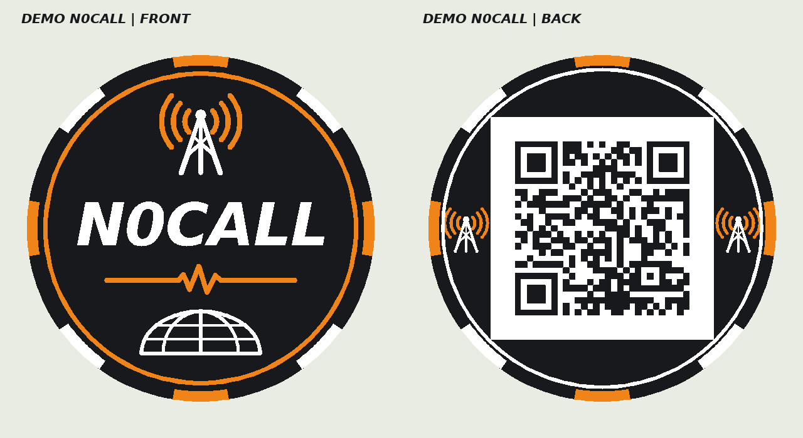

# Callsign Chip Builder

Browser-local customizer for flat, double-sided amateur-radio contact chips.

**[Open the customizer](https://ellaleks.github.io/callsign-chip-builder/)**

Enter your callsign and contact details, choose size and colours, and download three STL colour parts plus a multipart 3MF. Choose plain text for a compact QR or vCard 3.0 for contact-saving scanners. Data and geometry are processed in your browser; the application has no upload endpoint or analytics.

- Dark body with full-thickness rim inserts; all face details flush.
- Diameter 40–90 mm, thickness 2.4–5 mm in 0.1 mm increments.
- Real QR geometry with a four-module quiet zone, actual module-size calculation and a nozzle-size warning.
- Three colour roles: body, light QR field, accent. Use your own printer and purge profiles.
- Print QR up, callsign face on the bed. Try 0.20 mm first layer and 0.10 mm subsequent layers.

## Downloads and source

- [Full editable source](Callsign_Chip_Builder_source.zip), including the readable JS modules, vendored dependencies, tests and GitHub Actions workflow.
- [Printables pack](Callsign_Chip_Builder_Printables.zip): a sanitized sample model and draft listing text.
- [Russian instructions](README_RU.md).
- [Digital validation report](VALIDATION.json).

This repository serves a self-contained `index.html` distribution so the app can be deployed without a build. Complete editable sources are in the linked ZIP. The static page includes its JS, WebAssembly, font and styles; no CDN is needed at runtime. To develop, extract the source ZIP and follow its README.

## Validation limits

Prototype v0.1. Four parameter sets were generated and independently checked: exported STL watertightness, normals, colour intersections and exact QR payloads. Three full back-face images decoded directly in OpenCV. The 40 mm / QR-version-1 test decoded after isolating the QR field but not from the decorated full face. A sample 3MF roundtrip through PrusaSlicer retained three colour parts.

**Physical printing and printed QR scanning have not been validated.** Print and scan a sample before making a batch. vCard recognition and the offer to save contacts depend on your phone and scanning app. A suitable geometric module size does not guarantee scan reliability.

## License and privacy

Original code: MIT. Libraries and font retain their upstream licenses; see THIRD_PARTY.md and THIRD_PARTY_LICENSES.txt. Contact information in generated exports belongs to the person entering it. The public sample uses fictional demonstration data. Do not publish private contact exports by accident.

Maintainer: [ellaleks](https://github.com/ellaleks). Printables profile: [AlexEll](https://www.printables.com/@AlexEll_1847124).
